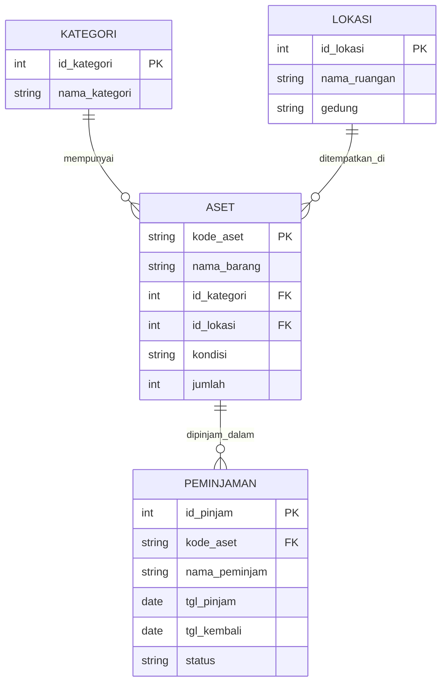

# Perancangan Sistem Manajemen Sarana dan Prasarana (Asset Management)

**Mata Kuliah:** Pemrograman Web 2 (Client-Side Programming)  
**Tugas:** Milestone 1 (Project-Based Learning)  
**Nama Mahasiswa:** [Agus Shuherman]  
**NIM:** [231011402716]  
**No. Presensi:** 2

---

## 1. Hirarki Navigation Menu (Sidebar / Navbar)

- 📊 **Dashboard**

  - Summary Card (Total Aset, Kondisi Baik, Perlu Maintenance, Dipinjam)
  - Grafik Kondisi & Peminjaman Aset
  - Activity Log / Aktivitas Terbaru

- 📦 **Data Master Aset**

  - Daftar Inventaris Barang/Sarana
  - Kategori & Spesifikasi
  - Lokasi / Ruangan Asset

- 📝 **Kelola Aset & Peminjaman**

  - Form Input Aset Baru
  - Form Edit / Update Kondisi
  - Pengajuan & Status Peminjaman

- 🖨️ **Laporan & Rekapitulasi**
  - Laporan Asset Maintenance
  - Cetak Rekapitulasi Sarana Prasarana

---

## 2. Conceptual Database / ER-D (Mermaid.js)

2. Link Figma
https://www.figma.com/design/jNnscKeUEmwbXRBYmQmzXD/Untitled?node-id=0-1&t=7OtVz41rUDcwAnkH-1
